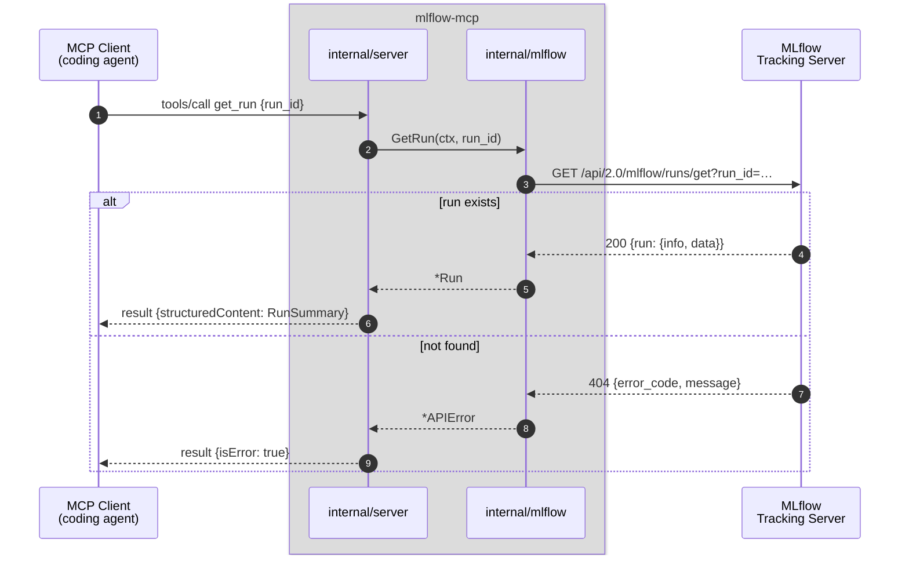

# mlflow-mcp-go

An [MCP](https://modelcontextprotocol.io) server, written in Go with the
official SDK, that exposes a read-only [MLflow](https://mlflow.org) tracking
server to coding agents: list experiments, search runs, read one run, compare
runs.

It speaks [stdio](https://modelcontextprotocol.io/specification/2025-06-18/basic/transports#stdio)
JSON-RPC to the client and plain HTTP to MLflow. Mutations — logging metrics,
creating experiments, promoting registry models — are deliberately out of scope.

## Status

v0.1, read-first. The surface below is implemented and covered by tests; the
"planned" rows are not yet.

## What it exposes

| Type | Name | Question it answers |
| --- | --- | --- |
| Tool | `list_experiments` | *"What experiments exist?"* |
| Tool | `search_runs` | *"Which runs match this filter, or are best by this metric?"* |
| Tool | `get_run` | *"What happened in this run?"* (params, latest value per metric, selected tags) |
| Resource | `mlflow://experiments` | The experiment list: id, name, lifecycle stage |
| Resource | `mlflow://runs/{run_id}` | The same summary as `get_run` |
| Prompt | `compare-runs` | Instructs the model to fetch runs and report only what differs |

Planned: `mlflow://runs/{run_id}/raw` (the full, unshaped MLflow JSON).

## Scope

| In scope (v0.1) | Out of scope |
| --- | --- |
| `list_experiments`, `search_runs`, `get_run` | Logging metrics/params/tags from the agent |
| Resources: experiments, run summary | Creating or deleting experiments and runs |
| `compare-runs` prompt | Model registry and model versions |
| Shaped, summarised output | Artifact download/upload |
| Typed errors, no panics | Auth, retries, caching layers |

A tool earns its place only if it answers a question an agent would otherwise
answer with several API calls and a lot of reasoning. A pass-through proxy of
the MLflow API is the one thing this server deliberately is not.

## Configuration

`MLFLOW_TRACKING_URI` — the tracking server base URL. Defaults to
`http://localhost:5000`.

```bash
MLFLOW_TRACKING_URI=http://host:5000 go run .
```

## Quickstart

```bash
# 1. MLflow tracking server, from the repo root (needs a Python venv)
source .venv/bin/activate
mlflow server --backend-store-uri sqlite:///mlflow.db --port 5000
# 2. Seed it with runs that exercise the server's edges
python scripts/seed_mlflow.py            # python scripts/seed_mlflow.py --reset to redo
# 3. Inspect the MCP server
npx @modelcontextprotocol/inspector go run .
```

Notes:

- `go run .` needs the trailing dot; `go run mlflow-mcp-go` treats the argument
  as an import path and fails with *"not in std"*.
- The MLflow server takes roughly 10–15 seconds to become healthy; `/health`
  returning nothing for a moment after launch is normal.
- The Inspector connects over stdio, so anything the server writes to stdout
  that is not JSON-RPC will corrupt the stream — keep logging on stderr.

## Architecture

```
cmd → (main.go at the repo root for now)
internal/mlflow/     a plain HTTP client: client.go, types.go, errors.go
internal/server/     the MCP adapters: tools.go, resources.go, prompts.go
scripts/             seed_mlflow.py, a fixture generator for manual testing
```

`internal/mlflow` never imports `mcp`; `internal/server` never issues HTTP
directly. The client is a plain HTTP client, and the server layer adapts it.
That one seam is the whole design:



Every arrow into `internal/mlflow` is HTTP; every arrow into `internal/server`
is JSON-RPC. `search_runs` loops inside `internal/mlflow` over `page_token`
until it has `max_results` runs or the server is exhausted, then reports
`truncated` rather than handing the model a cursor.

Error semantics differ per surface, deliberately:

- **Tools** return errors as an `isError` result, not a protocol failure — the
  session stays alive, and the model can read the message.
- **Resources** return protocol errors; a missing run is a clean
  `resource not found`, and a backend failure is *not* allowed to masquerade as one.
- **Prompts** reject bad arguments with `-32602` (invalid params), never
  `-32603` (internal error), so a client can tell "you asked wrong" from
  "the server broke".

## Testing

```bash
go test ./... -race
```

Unit tests never need a live MLflow server. The client is tested against
`httptest`; the server layer is tested wire-level over the SDK's in-memory
transport, so assertions are about what a client actually receives rather than
what a handler returns. The failure paths assert the invariant from the
project's history: a down MLflow server returns an error and the session
survives.

## Dependencies and license

- Go 1.26
- [`github.com/modelcontextprotocol/go-sdk`](https://github.com/modelcontextprotocol/go-sdk)
  pinned to `v1.8.0` — the protocol moves fast; the version is stated here on
  purpose.
- MLflow 3.x, targeted through its `/api/2.0/` REST prefix (that prefix is the
  API version, not the MLflow version).

MIT — see [LICENSE](LICENSE).
